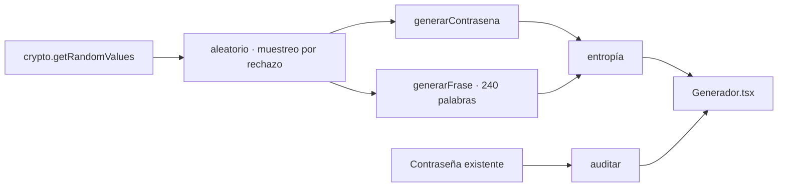

<div align="center">

# 🔐 Generador de contraseñas

**Crea contraseñas y frases seguras, y audita qué tan fuerte es la que ya usas.**

Generado con el criptógrafo del navegador. Nada sale de tu equipo.

[](https://nextjs.org)
[](https://www.typescriptlang.org)
[](https://tailwindcss.com)
[](https://vercel.com)

🌐 **[herramientas.totalsecuritysh.com/contrasenas](https://herramientas.totalsecuritysh.com/contrasenas)**

</div>

## ✨ Funcionalidades

| | |
|---|---|
| 🎲 **Contraseñas** | Longitud de 8 a 64, mayúsculas, minúsculas, números y símbolos. Opción para quitar caracteres ambiguos (0/O, 1/l/I). |
| 🗣️ **Frases de paso** | 3 a 8 palabras en español, separador a elegir, mayúscula inicial y número opcional. Fáciles de recordar y de teclear. |
| 📏 **Entropía real** | Muestra los bits de entropía y el tiempo estimado para romperla. |
| 🕵️ **Auditoría** | Revisa una contraseña existente: contraseñas comunes, secuencias (1234, qwerty), repeticiones y años. |
| 🔒 **Privacidad** | Sin servidor: la generación y la auditoría ocurren en el navegador. |

## 🏗️ Arquitectura



```
src/
├── app/                    página y layout (basePath /contrasenas)
├── components/
│   ├── Generador.tsx       pestañas: contraseña · frase · auditoría
│   └── GeneradorClient.tsx carga solo en el navegador
└── lib/
    └── passwords.ts        generación, entropía y auditoría
```

### ¿Por qué muestreo por rechazo?
Usar `random % n` hace que algunos caracteres salgan más que otros. `aleatorio()` descarta los valores que provocarían ese sesgo, así cada carácter y cada palabra tienen exactamente la misma probabilidad.

### Multi-zones
Esta herramienta es una **zona** del hub [`tsh-herramientas`](https://github.com/TotalSecurity-SH/tsh-herramientas). Se publica con `basePath: "/contrasenas"` en su propio proyecto de Vercel y el hub la sirve en `herramientas.totalsecuritysh.com/contrasenas` mediante *rewrites*. Cada herramienta vive en su propio repo, pero el usuario ve una sola plataforma.

## 🚀 Correr en local

```bash
git clone https://github.com/TotalSecurity-SH/generador-contrasenas.git
cd generador-contrasenas
npm install
npm run dev
```

Abre http://localhost:3000/contrasenas

| Script | Qué hace |
|---|---|
| `npm run dev` | Servidor de desarrollo |
| `npm run build` | Compilación de producción |
| `npm run typecheck` | Genera tipos de rutas y revisa TypeScript |
| `npm run lint` | ESLint |

## ☁️ Desplegar en Vercel

1. Importa el repositorio en [vercel.com/new](https://vercel.com/new).
2. Framework: **Next.js**. No requiere variables de entorno.
3. **Deploy**. Queda en `https://<proyecto>.vercel.app/contrasenas`.
4. En el proyecto del hub, define `CONTRASENAS_URL` con esa URL y vuelve a desplegar el hub.

<div align="center">

Hecho por **[Carlos Santiago](https://carlossantiago.totalsecuritysh.com)** · [Total Security SH](https://totalsecuritysh.com) · Full Stack Developer · IA y Automatización

</div>
